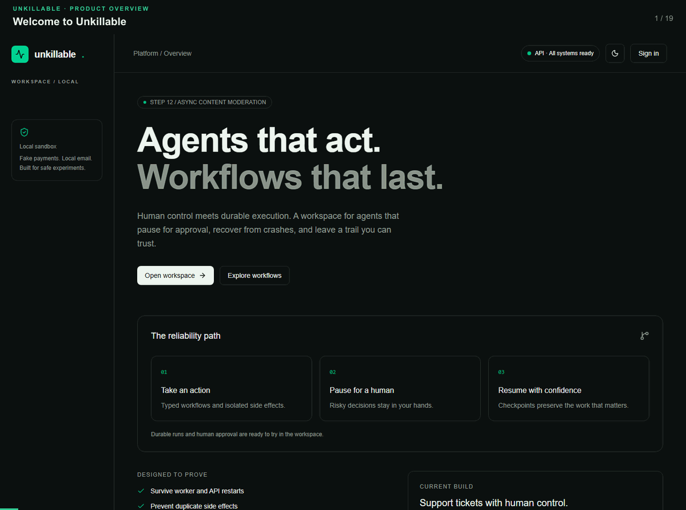
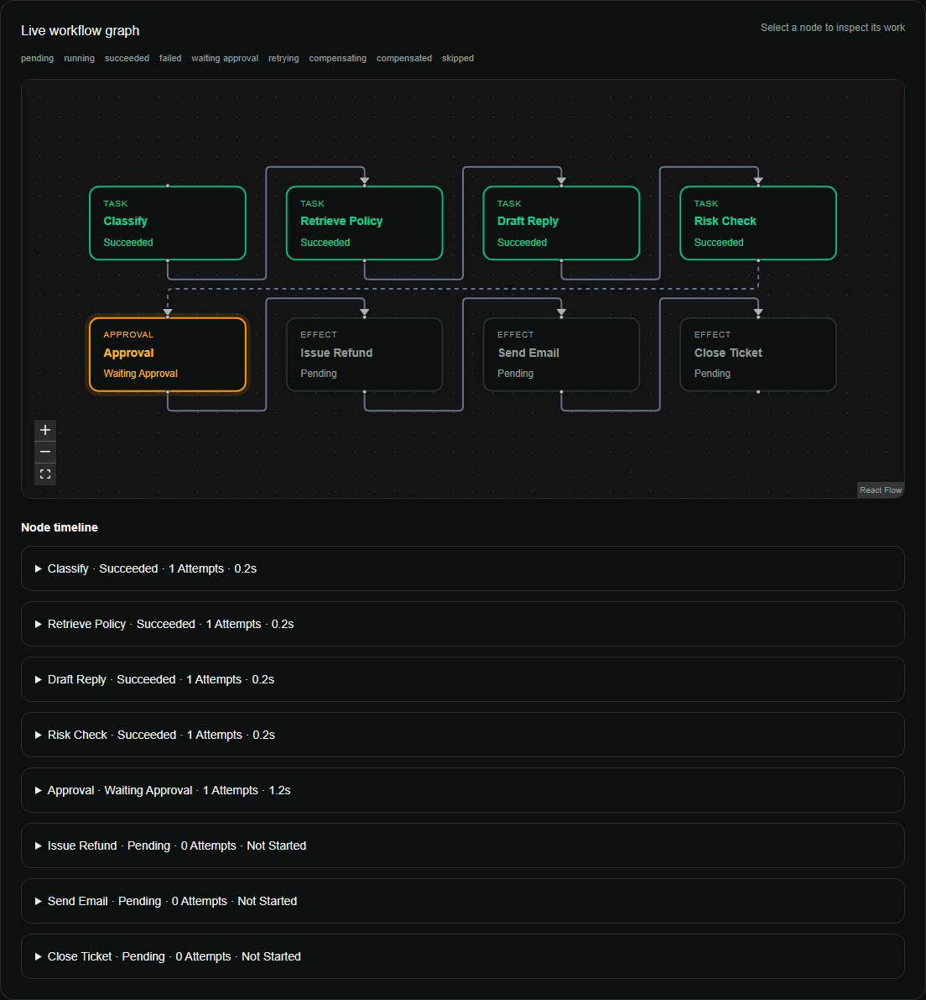
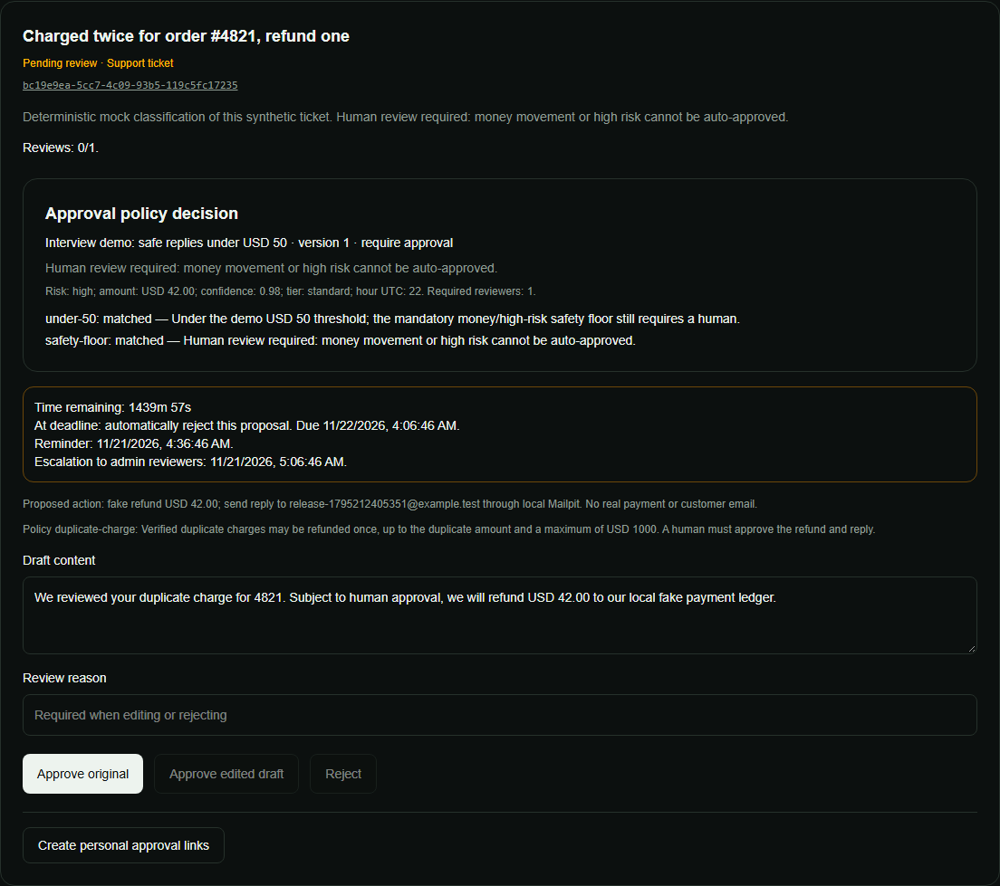
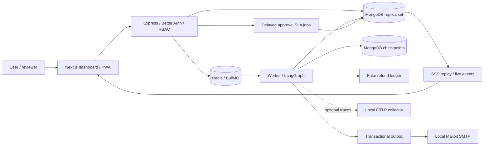

# Unkillable Agent Workflows

**I called it unkillable, so I built a button to kill it.**

Durable agent workflows that pause for human approval, survive worker crashes and make recovery visible.

[](https://github.com/jahidkhantuhin/unkillable-agent-workflows/actions/workflows/ci.yml)
[](LICENSE)
[](docs/STEP-16.md)

A TypeScript monorepo with two workflows: support-ticket refunds and asynchronous text moderation. Every demo uses **fake payments, synthetic `.test` customers and local Mailpit email**. MockLLM runs without API keys. Optional Gemini/Ollama, Telegram/WhatsApp and OrgMind adapters are separate opt-ins.

## Product tour



A 51-second tour of the real application using synthetic demo data. [Browse all 19 full-page screenshots](docs/SCREENSHOTS.md) for readable details, including long timelines and checkpoint views.

## Quickstart — four commands

Prerequisites: Node.js 24+, pnpm 12.16.1, and Docker Desktop with its Linux engine running. Open a terminal in this checkout:

```powershell
pnpm install --frozen-lockfile
pnpm demo:setup
pnpm seed:demo
pnpm dev
```

`demo:setup` creates `.env` **only if missing**, generates a private signing secret, selects MockLLM, disables external channels/chaos, and starts Compose. Existing `.env` files are retained unchanged: select `SUPPORT_LLM_PROVIDER=mock` for this walkthrough and keep optional channels disabled. `seed:demo` creates local demo accounts, the order #4821 example and a versioned policy; it starts no workflow and sends no messages. It refuses production/non-local MongoDB and preserves conflicting custom policies. See [demo setup and troubleshooting](docs/DEMO-SCRIPT.md).

Open [localhost:3000](http://localhost:3000). Default **local-only** accounts:

| Role     | Email                      | Password                       |
| -------- | -------------------------- | ------------------------------ |
| Admin    | `admin@unkillable.test`    | `local-demo-admin-password`    |
| Approver | `approver@unkillable.test` | `local-demo-approver-password` |

Override `DEMO_ADMIN_*` / `DEMO_APPROVER_*` in private `.env` before first seed if desired. Existing account passwords are never reset. These published credentials are for a local synthetic demo, not deployment. Mailpit is at [localhost:8025](http://localhost:8025).

## See it work

1. Sign in as admin. Open **Runs → New ticket → Load an example** and select **Charged twice for order #4821, refund one**.
2. Start the workflow. Watch classification, policy retrieval and drafting complete. The USD 42 refund matches the demo's USD 50 threshold, but the mandatory money/high-risk safety floor requires human review.
3. Open **Approval Inbox**. Review/edit directly or create a personal signed link; opening a link does nothing until confirmation. Telegram is unnecessary.
4. Approve, return to the run and inspect **one active fake refund**, **one sent Mailpit reply**, stable receipts and checkpointed timeline nodes.
5. For supervised crash/recovery, compensation and checkpoint forks, follow the [five-minute interview script](docs/DEMO-SCRIPT.md). Enable development chaos explicitly before using crash controls.




## What is implemented

- **Durable execution:** BullMQ dispatch and stalled-job recovery; LangGraph checkpoints in MongoDB; durable dispatch reconciliation.
- **Reliable local effects:** transactional idempotency receipts, outbox, bounded retry/backoff, dead letters and reverse-order saga compensation.
- **Human control:** approve/edit/reject, distinct-reviewer quorum, immutable reviewed edits, versioned policy traces, dry-run and reviewer analytics.
- **Visible debugging:** live React Flow graph, ordered SSE timeline with reconnect replay, checkpoint history/diffs and isolated forks.
- **Two workflows:** support routing/refund/email and full-text moderation with drag-and-drop file upload and local idempotent publication.
- **Approval channels:** web inbox, expiring personal signed links, optional Telegram and WhatsApp, plus a network-only installable PWA.
- **Operations:** approval SLA reminders/escalation/expiry, global animated notification bell, node tracing, model usage and known cost estimates.
- **Evidence:** deterministic models in tests, local service integration, Playwright browser coverage and a seeded chaos harness.

The PWA requires a connection. It does not bundle the backend, queue offline approvals or receive browser-closed push notifications. Local API, worker, MongoDB and Redis must remain running.

## Architecture



| Workspace            | Responsibility                                                     |
| -------------------- | ------------------------------------------------------------------ |
| `apps/web`           | Dashboard, approval review, graph, timeline and PWA                |
| `apps/api`           | HTTP/auth/RBAC, mutations, SSE, notification and SLA coordination  |
| `apps/worker`        | Checkpointed workflow execution, retries, effects and compensation |
| `apps/chaos`         | Isolated seeded failure harness and measured reports               |
| `packages/shared`    | Zod schemas, event contracts and deterministic policy rules        |
| `packages/storage`   | MongoDB repositories, transactions, indexes and local effects      |
| `packages/workflows` | Typed workflow graphs, providers, retry and tracing                |

## Measured chaos evidence

Copied from the [generated 500-run report](docs/CHAOS-REPORT.md) and its [JSON evidence](docs/CHAOS-REPORT.json), generated **2026-11-15T22:17:32.917Z**. This is a historical local measurement, not a new release-run claim or production SLA.

| Metric                                     | Measured value |
| ------------------------------------------ | -------------: |
| Terminal runs                              |      500 / 500 |
| Succeeded / compensated                    |       421 / 79 |
| Duplicate refund records                   |              0 |
| Duplicate email intents / Mailpit captures |          0 / 0 |
| Lost / nonterminal runs                    |              0 |
| Worker recovery p95                        |       5,856 ms |
| API recovery p95                           |       2,726 ms |

Seed `20261116`, batch size `8`, MockLLM, one worker; worker lock/stalled settings differ from normal development. Distinct duplicate jobs demonstrate redelivery; integration tests cover concurrent effects. SMTP capture deduplication depends on stable Message-IDs **and Mailpit's configured receiver deduplication/data retention**. Corrections are intentional extra messages. This does not establish exactly-once delivery through arbitrary external SMTP or payment providers.

## Design decisions and trade-offs

- **Why LangGraph checkpoints plus BullMQ:** checkpoints preserve completed graph state; the queue supplies dispatch, locks and stalled recovery. The interrupted step can execute again, so checkpoints alone do not make effects safe.
- **Why idempotency keys and an outbox:** unique transactional receipts prevent duplicate ledger/intents; the outbox separates database commitment from delivery. Receiver deduplication remains necessary across SMTP acceptance/acknowledgement crashes.
- **Why a separate repository from OrgMind:** this project demonstrates controlled actions and recovery, independently of a retrieval product. A local stub is sufficient; the optional permission-aware HTTP retriever stays behind an interface.
- **Why explicit human review:** money/high-risk actions cannot be auto-approved by a permissive rule. Every channel uses current membership, proposal version and transactional decision checks.
- **Why estimates rather than billing totals:** model usage/pricing may be missing after failures; the UI shows unknowns and known subtotals rather than invented zeroes.

Read the [ADRs](docs/DECISIONS.md) and [architecture boundaries](docs/ARCHITECTURE.md).

## Verification and release

After stopping your managed development session, run:

```powershell
pnpm check
pnpm test:integration
pnpm test:e2e
pnpm chaos --runs 50 --seed 20261116 --report-dir docs/chaos-release
```

Docker services must be running. Tests use isolated databases/queues, mock models and synthetic recipients. Policy integration tests prepare indexes and real authenticated users in a separate bounded setup hook; their assertions retain their original time limits. A timeout during setup and a policy assertion failure are reported separately. CI runs lint, typechecks, unit tests, integration, build, a seeded chaos gate and Chromium browser tests. Failure/incomplete invariant evidence produces a nonzero exit. Use `pnpm dev:stop` to stop only the managed development processes; the project does not mount a Docker socket.

Release target: **v1.0.0**. Package version preparation is separate from creating a Git tag or publishing a GitHub release. See the [release checklist and actual verification status](docs/STEP-16.md); the user performs Git operations. No tag or remote CI success is implied by this README.

## Documentation and roadmap

| Area                            | Guide                                                                           |
| ------------------------------- | ------------------------------------------------------------------------------- |
| Start / interview demo          | [DEMO-SCRIPT](docs/DEMO-SCRIPT.md)                                              |
| Architecture / decisions        | [ARCHITECTURE](docs/ARCHITECTURE.md), [DECISIONS](docs/DECISIONS.md)            |
| Development / troubleshooting   | [DEVELOPMENT](docs/DEVELOPMENT.md), [CONTRIBUTING](CONTRIBUTING.md)             |
| Human approvals / channels      | [Step 14](docs/STEP-14.md), [WhatsApp setup and limits](docs/WHATSAPP-LOCAL.md) |
| Deadlines / tracing / costs     | [Step 15](docs/STEP-15.md)                                                      |
| Crash evidence                  | [Chaos report](docs/CHAOS-REPORT.md), [Step 10](docs/STEP-10.md)                |
| Implementation / release status | [PROGRESS](docs/PROGRESS.md), [Step 16](docs/STEP-16.md)                        |

Roadmap: foundation/auth (1–2), durable execution/reliability (3–4), approvals/support/sagas (5–7), graph/chaos proof (8–10), policy/moderation/forks (11–13), remote review/operations (14–15), demo/documentation/release preparation (16). Actual verification and remaining release actions are in PROGRESS; unverified integrations are not presented as completed live demonstrations. The private build prompt remains excluded from GitHub.

## Author

**Jahid Khan Tuhin — Full Stack JavaScript Engineer**

GitHub: [placeholder] · LinkedIn: [placeholder] · Email: [placeholder]

[MIT License](LICENSE) · Maintainer: Jahid Khan Tuhin
