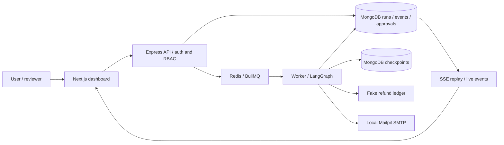

# Unkillable Agent Workflows

Durable agent workflows with human approval, built to demonstrate recovery you can inspect.

The platform targets five goals: crash durability, exactly-once side effects, human control, debuggable run history, and measured chaos-test evidence. This is a separate project from OrgMind; a future optional HTTP retriever adapter is its only integration.

## Current scope

Steps 1–11 provide durable execution, human approval, a support ticket router, reverse-order compensation, a live React Flow graph, an admin-only development Chaos panel, a seeded service-backed chaos suite, and versioned approval policies with reviewer analytics. Runs survive worker restarts and expose effect receipts. Support effects use fake payments and local Mailpit only. MockLLM is the code default; set SUPPORT_LLM_PROVIDER=mock for predictable local testing if your copied environment selects Gemini. The chaos harness forces MockLLM and isolated local services; measured results and limitations are published in [docs/CHAOS-REPORT.md](docs/CHAOS-REPORT.md).

## Architecture



## Quickstart

Install Node.js 24 or newer, pnpm 12.16.1, and Docker with Compose. From the repository root:

```powershell
Copy-Item .env.example .env
# Replace BETTER_AUTH_SECRET with the output of:
node -e "console.log(require('node:crypto').randomBytes(32).toString('hex'))"
pnpm install
docker compose up -d
pnpm seed
pnpm dev
```

Open http://localhost:3000. The API badge turns green when MongoDB and Redis are reachable. The worker logs `Worker ready`, then its health every 30 seconds. The API is at http://localhost:4000/health; Mailpit is at http://localhost:8025. Stop app processes with Ctrl+C and infrastructure with `docker compose stop` (retains data).

`pnpm dev` now uses a managed launcher for web/API/worker rather than nested parallel package-manager processes. Ctrl+C stops the complete development process trees. If the original terminal is stuck, open another terminal in this repository and run:

```powershell
pnpm dev:stop
```

The fallback verifies recorded process commands belong to this workspace before stopping them. It handles sessions started with the root `pnpm dev`; Docker services remain running. Duplicate managed sessions are refused. Windows development shutdown terminates the child trees, so an interrupted active run may repeat its unfinished step after restart; checkpoints and effect receipts still protect committed work. Unix shutdown sends termination to each process group with a bounded force-stop fallback.

Successful API GET requests log at debug level instead of flooding info output; errors and mutations remain visible, and request/response logs omit headers. Use the existing LOG_LEVEL=debug setting when investigating polling requests. Periodic run/health GETs are expected background updates, not page reloads. Stop the dev session before running production builds/checks to avoid generated-file interference.

MongoDB runs as a single-node replica set. The one-shot initializer safely initiates `rs0` on a fresh volume. Host applications use `directConnection=true` because the replica set advertises the internal Compose hostname `mongo`. Services bind only to local loopback ports. This setup is for local development.

API and worker load the root `.env`. Existing Step 1 installations must add `BETTER_AUTH_SECRET` (a private random value, at least 32 characters) and `BETTER_AUTH_URL=http://localhost:4000`. Keep `CORS_ORIGINS=http://localhost:3000`; auth mutations require an allowed `Origin` header. No model, payment, SMTP, or Telegram credentials are needed.

For a custom API address, set `API_INTERNAL_URL` in `apps/web/.env.local` and update `NEXT_PUBLIC_API_URL` there for the health proxy. Both default to `http://localhost:4000`. The signing secret belongs only in the API environment; never expose it through a `NEXT_PUBLIC_` variable.

The header and navigation receive a server-verified session with the initial page, avoiding a second verification request after hydration. Requests without cookies skip the session API. Session checks are shared only within each server render, not across users/requests; pages remain private and dynamic. Focus refresh still checks current permissions, concurrent refreshes share one request, and a failed or timed-out check offers Retry instead of an indefinite Checking session message. `pnpm dev` still compiles pages on first access after startup; that development compilation can take time even when session verification is ready. See the [Next.js authentication guide](https://nextjs.org/docs/app/guides/authentication) for request-scoped session loading.

## Development bundler: why Webpack

A bundler prepares application code and assets for the browser and server. Next.js supports both Turbopack and Webpack; changing the development bundler does not change this app's workflows, authentication, or database behavior.

| Aspect             | Turbopack                                                                                    | Webpack                                                               |
| ------------------ | -------------------------------------------------------------------------------------------- | --------------------------------------------------------------------- |
| Approach           | Rust-based incremental bundler built into Next.js; designed for fast compilation and updates | JavaScript-based bundler with a mature loader/plugin ecosystem        |
| Next.js 16 default | Used by plain `next dev` and `next build`                                                    | Explicitly selected with `--webpack`                                  |
| Configuration      | Uses Next.js's `turbopack` options; does not apply a custom `webpack()` configuration        | Uses Next.js's `webpack()` hook and supported Webpack loaders/plugins |
| Current use here   | Production web builds via `pnpm build`                                                       | Local web development via `pnpm dev` or the web app's dev script      |

**Why we switched development:** on this Windows setup with Next.js 16.4.6, the Turbopack dev session repeatedly recompiled and fully reloaded the browser without source edits. It disrupted the page and generated repeated API requests. With `next dev --webpack`, the observed loop stopped and unsent form text stayed intact during background polling. The exact upstream trigger is unconfirmed; this is a verified local stability workaround, not a claim that Turbopack is generally unreliable or that Webpack is faster. No comparative performance benchmark was run. Webpack still supports automatic updates after actual source edits, and first compilation still takes time.

Only development changed: `scripts/dev.mjs` and `apps/web/package.json` select `next dev --webpack`; production still runs `next build` with Turbopack. The stuck-terminal issue was handled separately by the managed launcher and `pnpm dev:stop`; selecting Webpack alone does not guarantee process cleanup. See [the verification record](docs/PROGRESS.md#step-5-follow-up-dev-reload-loop-and-terminal-shutdown) for the browser and shutdown checks. Any future return to Turbopack should repeat the idle-page, source-edit refresh, startup, and shutdown checks on this setup.

### Production builds with Turbopack

Production already uses Turbopack: the web build script is `next build`, which selects Turbopack by default in the installed Next.js 16.4.6. The development-only `--webpack` flag does not carry over to builds. Stop the dev session first, then build the workspace:

```powershell
pnpm dev:stop
pnpm build
```

To explicitly select Turbopack for a web production build, including when switching back from a Webpack build command, use:

```powershell
pnpm --filter @unkillable/web exec next build --turbopack
```

For a permanent production selection, set `apps/web/package.json`'s build script to `next build --turbopack` (replace `next build --webpack` if present). The existing plain `next build` already has the same bundler selection, so no edit is needed in this checkout. Keep the web dev script and managed launcher's `next dev --webpack` unchanged if you want to retain the local stability workaround.

After a successful build, serve the production web app with:

```powershell
pnpm --filter @unkillable/web exec next start
```

The API, worker and infrastructure must also be running with their deployment configuration. `next start` serves the generated build; it does not choose or switch bundlers at runtime. Confirm the build output reports Turbopack. Before deploying a changed bundler configuration, run the normal `pnpm check` and `pnpm test:integration` checks.

Official references: [Next.js Turbopack](https://nextjs.org/docs/app/api-reference/turbopack), [Next.js CLI bundler options](https://nextjs.org/docs/app/api-reference/cli/next), and [Webpack concepts](https://webpack.js.org/concepts/).

## Authentication and roles (Step 2)

Register at `/register`; accounts start as viewers. Registration accepts name, email, and a password of 12–128 characters; callers cannot supply a role. The seed command creates the local administrator using `SEED_EMAIL`, `SEED_PASSWORD`, `SEED_NAME`, and `SEED_ROLE` from `.env`. Example defaults are **local demo credentials only**: `admin@example.test` / `local-demo-password-change-me`. Set your own values before seeding if preferred. Re-running seed preserves existing passwords and applies the configured role; seeding is disabled in production.

| Role     | Workspace access                                                  |
| -------- | ----------------------------------------------------------------- |
| viewer   | Runs and Workflows                                                |
| approver | Viewer access plus starting demos/tickets and resolving approvals |
| admin    | All sections, including Chaos, Policies and Analytics             |

Step 2 established section access; Step 5 implements approval actions. Navigation hides unauthorized sections, protected pages recheck the session on the server, and API permission checks read the current membership on every request. Role changes do not require re-login; the navigation refreshes on window focus. Missing memberships fail closed. This is one local workspace (`workspaceId=local`), not a multi-tenant implementation.

API endpoints: `POST /auth/register`, `POST /auth/login`, `POST /auth/logout`, `GET /auth/me`, and `GET /auth/access/:section` (a permission check, not workflow execution). Browser requests use the same-origin `/api/backend/auth/*` proxy, which forwards HTTP-only cookies. API responses do not expose session tokens. Better Auth 1.7.23 hashes passwords and stores sessions in MongoDB. Sessions have a fixed seven-day lifetime, no cookie cache, and server-side revocation on logout; production cookies are Secure, all session cookies are HttpOnly/SameSite=Lax. Auth mutations require trusted origins, native auth rate limits use the database, and logs redact cookies and authorization headers. Email verification and password recovery are not configured in this local showcase; those auth flows send no email.

The app bootstraps indexes before accepting API traffic; `pnpm db:migrate` repeats the same idempotent bootstrap manually. Collections:

| Collection                                        | Purpose                                                               |
| ------------------------------------------------- | --------------------------------------------------------------------- |
| users, memberships                                | Identity and the workspace role                                       |
| sessions, accounts, verifications, authRateLimits | Better Auth session, credential, verification, and rate-limit storage |
| workflowDefinitions                               | Versioned workflow structure                                          |
| runs, runEvents                                   | Execution state and append-only event history                         |
| approvals                                         | Pending proposals and immutable reviewer decisions                    |
| idempotencyKeys                                   | Committed effect results returned unchanged on replay                 |
| deadLetters, outbox                               | Failed-work context and transactional outbound intents                |
| nodeAttempts, localDeliveries                     | Durable retry budgets/deadlines and the local notification sink       |

The unique `idempotencyKeys.key` index is tested. Other indexes protect emails, memberships, event sequence numbers, and outbox keys. Shared Zod schemas define every document and the AG-UI-shaped run-event union; application repositories validate writes and reads. Better Auth owns its MongoDB adapter and auth-record lifecycle. Execution now uses transactional run/event writes; the unique index alone does not claim exactly-once external effects.

## Support ticket router (Step 6)

Open **Runs → New ticket** as an admin or approver. Load the duplicate-charge example, start it, and inspect classify → retrieve_policy → draft_reply → risk_check → approval → issue_refund → send_email → close_ticket. By default every ticket pauses before its effects; Step 11 policies can auto-approve low-risk replies or require two distinct reviewers. Refunds always need human approval. Approve the original, edit the reply, or reject with a reason. An approved duplicate-charge example produces one fake USD 49.00 refund and one email captured at http://localhost:8025; how-to/general refund-review replies produce no automatic refund, and rejection produces neither effect.

`pnpm seed` upserts three synthetic ticket examples. New collections tickets, ticketExamples, fakeRefunds and fakeEmails retain verifiable state/effects. Inputs accept only .test recipients and local Mailpit SMTP; the worker never contacts a bank or real customer mailbox. MockLLM/local policies need no model key. Optional SUPPORT_LLM_PROVIDER=gemini or ollama enables configured adapters; tests always use mocks. Support node outputs, citations, proposed refund, approved reply and effect receipts appear on run detail and in the Approval Inbox.

Compose enables persistent Mailpit storage and duplicate Message-ID suppression. Replays use a stable ID; this receiver setting closes the SMTP acceptance/acknowledgement gap. Keep deduplication and retained messages intact; this is a local Mailpit guarantee, not a generic exactly-once SMTP claim. Step 7 now compensates committed support effects after terminal node failure, as described below.

See [docs/STEP-6.md](docs/STEP-6.md) for all example outcomes, new environment variables, adapter contracts, safety boundaries, retry/DLQ behavior and tests. Apply the updated Compose configuration with `docker compose up -d` before testing email capture. Stop dev and run `pnpm check` plus `pnpm test:integration` for verification.

## Live graph and node timeline (Step 8)

Every run timeline loads its versioned workflow definition into React Flow. Nodes show pending, running, succeeded, failed, pulsing waiting approval, retrying and compensation states. Edges animate toward active work; orange dashed edges show reverse compensation. Select a node to inspect recorded input/output, attempts and wall-clock elapsed duration. The grouped node timeline includes retry markers and reviewer identity/decision, while the raw ordered event log remains available below.

Timeline numbers identify events across the entire run. Node groups filter that history, so gaps such as #5 → #7 are intentional: #6 may be a saved-state snapshot shown in the full Event history. They are not per-node row numbers or evidence of missing events. See [the numbering example](docs/STEP-8.md#why-event-numbers-skip-in-the-node-timeline).

Fresh pages replay saved events from sequence zero. Reconnects resume after the last accepted event, deduplicate replay and recover gaps; final run state is refreshed when the stream completes. New runs persist node input/output with their start/checkpoint events. Older events remain valid, and missing historical payloads/timing are labelled unavailable instead of invented. Elapsed duration includes retries, downtime and human review.

See [docs/STEP-8.md](docs/STEP-8.md) for a short walkthrough, graph semantics and verification. `pnpm check` and `pnpm test:integration` cover the code/API; after a build, `pnpm exec playwright install chromium` then `pnpm test:e2e` runs the isolated approval-pulse/reload smoke test. The intended release milestone is v0.5; no Git tag is created automatically because the user manages commits and tags.

## Compensation and fault hooks (Step 7)

A terminal support-node failure after effects changes the run to compensating. The worker reads committed receipts, then reopens a closed ticket, sends one correction that voids the previous reply, and reverses the fake refund, in that reverse order where applicable. Completed compensations use stable executeOnce keys; an interrupted rollback resumes its saved plan rather than continuing the original graph. The final state is compensated, with the original failure retained. A failed compensation remains visible and is retried by worker maintenance every five seconds, including after restart. If no effects were committed, the existing failed/Dead Letters path applies.

No captured email can be recalled: the correction is a separate Mailpit message, with its own stable Message-ID. Refund cards show active/reversed; email cards distinguish reply/correction and mark the original voided. The timeline shows compensation actions and failures. Historical forward receipts/checkpoints remain evidence of what happened; they are not deleted or rewritten as if the effects never occurred.

CHAOS_ENABLED=false is the default. In development, per-run/node Redis flags support throw_once, throw_always, delay_ms and crash_process before/after work, including compensation. Step 9 adds the browser controls and supervisors below. See [docs/STEP-7.md](docs/STEP-7.md) for underlying hook behavior and [docs/STEP-9.md](docs/STEP-9.md) for current setup. Keep the flag disabled during normal use.

## Chaos control panel (Step 9)

Enabled Chaos buttons show a pointer cursor on hover; disabled controls show a not-allowed cursor.

The admin **Enable fault injection** switch shows Active / Paused / Unavailable. Pausing blocks new crashes/faults/model simulations at the server and worker, clears pending faults for runs in this application database and queued kill requests, resets the model profile and hides the red banner. Recovery/supervision continue. The queue's paused state persists in Redis across app restarts; resuming does not restore old faults. The switch cannot override CHAOS_ENABLED=false or production mode. With development chaos allowed and no saved pause, existing behavior starts Active. Restart pnpm dev once after installing this API/worker update.

For a local demonstration, set CHAOS_ENABLED=true and NODE_ENV=development in your existing .env, then restart pnpm dev. The launcher uses API/worker supervisors in this mode, and shows a red warning banner for signed-in users. As admin, open Chaos to crash either process, inspect up/down/restarting status and restart counts, or apply temporary slow/flaky model simulation. Run detail also offers node/phase-specific faults, including crash worker at this node. Mutations require admin permission, a trusted Origin and enabled development mode; disabled/production actions are refused. Supervisors themselves refuse disabled/production startup.

Supervisors spawn only this repository's child process, consume generation-specific Redis kill commands in that child, and restart it after CHAOS_RESTART_DELAY_MS (default 1000). No Docker socket, arbitrary PID or shell execution endpoint is exposed. Normal mode retains tsx watch. Chaos mode supervises direct app processes; restart pnpm dev after API/worker source edits. Ctrl+C/pnpm dev:stop still stop the managed group. After a forced supervisor stop on Windows, startup may wait up to ten seconds for its old Redis lease to expire; an existing live supervisor cannot be displaced.

Faults and model profiles expire after five minutes. Slow/flaky simulation applies before future classify/draft calls in this queue; it does not change an already prepared approval draft or simulate real provider billing. Flaky mode raises synthetic retryable 429/500 errors; tests always use MockLLM. Reset the model profile and clear persistent run faults when finished, then return CHAOS_ENABLED=false. See [STEP-9.md](docs/STEP-9.md) for three short manual checks and exact endpoints.

## Measured chaos suite (Step 10)

Measured locally: **500/500 terminal runs**, 421 succeeded and 79 compensated; **zero duplicate refunds, duplicate email intents, duplicate Mailpit captures, lost runs or stuck runs**. The receiver captured 579 intended messages, including 79 compensation corrections. Worker recovery p50/p95/p99 was 3119/5856/7134 ms (113 samples); API recovery was 2348/2726/3457 ms (44 samples). The measured campaign used `pnpm chaos --runs 500 --seed 20261116 --timeout-ms 600000`; the CLI's default wait limit remains 120000 ms. See the [generated report](docs/CHAOS-REPORT.md) for configuration and boundaries.

With local MongoDB, Redis and Mailpit running, `pnpm chaos` starts 500 mock support workflows in an isolated temporary database/queue. A seeded schedule injects worker/API crashes, temporary/permanent errors, delays, distinct duplicate job deliveries and crashes during compensation. A synthetic admin approves the tickets; no real customer or model service is used. The CLI checks MongoDB outcomes/effect receipts and actual Mailpit captures, then writes Markdown and JSON reports. Any invariant violation or incomplete evidence exits nonzero.

```powershell
docker compose up -d
pnpm chaos
# Lightweight CI-sized workload; keeps its report separate:
pnpm chaos --runs 50 --seed 20261116 --report-dir docs/chaos-ci
```

See [STEP-10.md](docs/STEP-10.md) for fault rates, options, invariants, cleanup and recovery definitions, and [CHAOS-REPORT.json](docs/CHAOS-REPORT.json) for per-run outcomes/event timestamps. Worker/API recovery percentiles are separate and reflect local test settings, not production SLAs. The seed reproduces the fault schedule, not execution timing. A correction is a separate intended email; SMTP capture deduplication depends on configured Mailpit storage. The workload uses one worker and duplicate redelivery; existing integration tests separately cover concurrent effect races. CI runs 50 tickets with a zero-violation gate and preserves the generated report as an artifact.

## Approval policies and analytics (Step 11)

Reviewer feedback uses the ticket title as its run link and the current reviewer's name for recognition. The run ID appears underneath in smaller text, and expandable Reviewer details retains the full reviewer ID. Missing titles/accounts fall back to IDs.

Policy version history also shows the author's current name, with the full user ID in expandable Author details. Dates/times use the browser's local timezone with a timezone label; hovering the timestamp reveals the original ISO value.

The new-ticket charge amount can be cleared while editing. Enter a whole-number amount in cents before submitting; an explicit 0 is valid, and a blank field is required rather than silently converted to zero.

Admins open **Policies** to edit ordered JSON rules, dry-run them against saved support decisions, activate immutable versions and inspect version history. Rules use risk, proposed refund amount, classifier confidence, synthetic customer tier and the run's creation hour in UTC. Outcomes are automatic approval, one reviewer or two distinct reviewers; refunds/high risk cannot bypass human review. The saved decision/trace appears on run detail and in the inbox. Existing waits retain their policy version, and two-reviewer edits are frozen after the first vote.

**Analytics** shows human-required decisions/all evaluated decisions, median request-to-final-approval time, final edited approvals/all resolved approvals, rejection reasons and daily auto-approved share. Feedback includes original/edited drafts, reviewer and reason; it never trains a model. Demo/legacy runs without policy decisions are excluded. Defaults preserve existing single-review behavior. See [STEP-11.md](docs/STEP-11.md) for the four main manual tests, second-reviewer setup, formulas and API/storage details. No new environment variables or dependencies.

## Human approval gates (Step 5)

On Runs, enable **Require human approval** before starting a new demo. Prepare and summarize finish, then the run pauses before its local notice is queued. The worker releases its slot so other jobs can run. Approvers/admins open **Approvals** to inspect the proposal and reasoning, approve the original, approve an edited draft, or reject with a reason. Decisions and reviewer identity appear on the live timeline. Approve/edit resumes the same saved graph; reject cancels without delivery. The inbox refreshes every two seconds; concurrent decisions resolve once. New version 3 runs default to no gate, so Step 4 scenarios still work unchanged. No new environment variables.

See [docs/STEP-5.md](docs/STEP-5.md) for the three action walkthroughs, API bodies, crash/outage recovery, permission rules, and verification commands. These use native [LangGraph interrupt/resume](https://docs.langchain.com/oss/javascript/langgraph/interrupts), not a waiting worker loop. Rejection is not a dead letter; resolved decisions remain immutable.

## Durable demo runs (Step 3)

Step 4 extends these runs with retries and a local outbox; see [docs/STEP-4.md](docs/STEP-4.md) for the four test scenarios, effect guarantees, admin Dead Letters actions, and per-node `NODE_RETRY_POLICIES` configuration.

Runs, run timelines, and Dead Letters share color-highlighted scenario names (healthy, transient recovery, exhausted retries, permanent failure). Each shows the independent test title so individual tests are easy to identify independently of notice content and execution status.

The Test title field names the run and appears first in a larger font, with the smaller highlighted scenario label immediately below and the run ID afterward. The separate Notice content field supplies the draft to review and deliver; approval edits change only that content. Older runs without a separate title continue to display their original message as the title.

Demo controls keep Start demo run right-aligned, alongside a bordered Require human approval checkbox. On smaller screens, the controls wrap below the scenario selector.

**What the worker does:** The API accepts requests and queues jobs. The worker performs the workflow work. The durability demo uses no AI model and sends no emails or payments. The support workflow defaults to MockLLM, records fake refunds in MongoDB, and sends replies only to local Mailpit. No real payment or customer email is sent.

**What happens if it crashes:** A replacement worker picks up the abandoned job and resumes from the last saved checkpoint. The interrupted step may run again; completed, checkpointed steps are preserved. Step 9's enabled development supervisor starts the replacement automatically. Without that supervisor, a replacement must be started manually. Process restart and BullMQ lock/stalled-job recovery are separate delays.

Sign in as the seeded admin, open **Runs**, enter a test title and notice content, choose a delivery scenario, and choose **Start demo run**. Approvers can start runs too; viewers can inspect them. The nodes are `prepare → summarize → complete`, with a configurable delay so progress is visible. Workflow versions 2 and 3 queue one local notice at complete; version 3 adds the optional approval gate and existing version 1 runs remain pure. No model, payment, email, or external action is called. The list refreshes automatically; each detail page shows the timeline, checkpointed steps, saved state, reconnect status, recovery events, effect receipts, and outbox deliveries.

`POST /runs` accepts `{"input":{"title":"Recovery test","message":"Keep this notice safe"}}` and returns HTTP 202. The optional workflowId is fixed to `durability-demo`. `GET /runs` supports limit (1–100) and status; `GET /runs/:id` returns state. Routes require a session; creation also requires a trusted Origin and runs:create permission. All runs are in the one local workspace. The server generates run UUIDs; clients never choose LangGraph thread IDs.

The API saves the queued run/event transactionally, then adds a BullMQ job with jobId=runId. Its five-second reconciliation loop (also run at startup) retries pending dispatch after an API crash or Redis outage. It never invokes graphs. The worker uses LangGraph.js 1.7.4 and MongoDBSaver 1.5.1 with thread_id=runId and synchronous durability. Completed nodes are reported after their native checkpoint write; missing notifications are reconciled on resume. An interrupted node can run again; version 2's local effect uses the durable receipt described below.

`GET /runs/:id/events` streams append-only MongoDB events with numeric per-run SSE IDs. Last-Event-ID resumes strictly after that sequence; a fresh client can use ?after=N. Invalid/ahead cursors are rejected. Completed runs replay through the same endpoint. Heartbeats and session rechecks occur every 15 seconds; writes respect backpressure, headers disable buffering, and disconnects stop polling. The Next.js proxy forwards the streaming body and cursor header. EventSource reconnects automatically; the UI deduplicates sequences and reconstructs history after refresh.

Optional settings in .env.example: RUN_QUEUE_NAME=workflow-runs, WORKER_LOCK_DURATION_MS=15000, WORKER_STALLED_INTERVAL_MS=5000, WORKER_MAX_STALLED_COUNT=3, DEMO_NODE_DELAY_MS=1500. API and worker must share a queue name. Locks renew every half lock duration; replacement workers recover expired locks during stalled scans. Exhausted stalled jobs enter failure handling; support effects can require compensation. Checkpoints are retained without TTL. Step 5 adds waiting_approval/cancelled, Step 7 implements compensation, and Step 9 adds development supervision and kill controls.

See [docs/STEP-3.md](docs/STEP-3.md) for boundaries and verification. Shared Node-only run/event persistence lives in `packages/storage`; browser code only imports shared contracts.

## Workspace

| Package              | Responsibility                                                                                            |
| -------------------- | --------------------------------------------------------------------------------------------------------- |
| `apps/web`           | Next.js App Router, Tailwind, local Button, themes, auth forms, protected pages and role-aware navigation |
| `apps/api`           | Express routes → controllers → services → repositories; health, Better Auth, RBAC and indexes             |
| `apps/worker`        | BullMQ consumer, LangGraph executor and checkpoint recovery                                               |
| `packages/shared`    | Zod document/API/event contracts, permissions and infrastructure configuration                            |
| `packages/workflows` | Typed demo definition, pure nodes and durable graph runtime                                               |

Validation results are available on `res.locals.body`, `.query`, or `.params`, avoiding mutation of Express 5 request getters. Health returns HTTP 503 with per-service flags when a dependency fails. Shutdown stops accepting work, closes connections, and has a ten-second deadline.

The worker allows up to twenty seconds for graceful shutdown; the API retains its ten-second deadline.

## Development checks

Before each push, Husky runs `pnpm check && pnpm test:integration`: lint/formatting → typecheck → service-free tests → production build → integration tests. This includes the SMTP-compensation recovery regression. The first failed command stops the sequence and blocks the push. You can run these commands manually without pushing. The pre-commit hook still runs lint-staged.

After pulling these changes, run `pnpm prepare` once to activate the Git hooks (normal `pnpm install` also runs prepare). Hook setup is skipped if `HUSKY=0` or `CI` is set. Hook files use LF endings on Windows too. Local hooks can be bypassed, so CI remains the remote check.

Pre-push checks require your configured .env and local MongoDB, Redis and Mailpit. Start them with `docker compose up -d` and stop managed development with `pnpm dev:stop` before pushing, so production builds do not share Next's output with a running dev server. The hook does not start Docker automatically. Missing MONGODB_URI/REDIS_URL fails explicitly rather than silently skipping required suites. GitHub CI already runs the same integration test files, including the compensation regression.

If `pnpm dev` reports missing `tsx` or Next.js CLI files, stop the dev processes, restore the installed packages and links with `pnpm install --frozen-lockfile --force`, then retry `pnpm dev`. A normal install can report everything up to date even when local package links are damaged. This repair keeps the dependency versions in the lockfile. If React declarations still fail to resolve, the generated hoisted links in `node_modules/.pnpm/node_modules` may also need rebuilding; remove only that generated directory and repeat the forced install.

The prepare script uses Husky 9's `bin.js` entry point and skips hook setup when `CI` is set, `HUSKY=0`, or the directory has no `.git` entry.

```powershell
pnpm lint
pnpm typecheck
pnpm test
pnpm test:integration
pnpm build
```

`pnpm test` runs auth, RBAC, schema, lifecycle, and health checks without external services or models. Integration files skip unless their connection variables are set. `pnpm test:integration` loads .env, uses random unkillable_test_* databases and a unique test queue, and removes only those resources. It covers persistent auth, indexes, run API/dispatch recovery, ordered events, SSE replay, a real child-worker kill followed by stalled recovery, the final-checkpoint crash boundary, and terminal redelivery. Tests never kill your normal worker or API.

CI runs on Node 24 and starts Compose services for the MongoDB integration suite before building the web app. `pnpm format` formats the workspace. Husky installs only when a Git checkout exists; lint-staged checks staged files.

Auth implementation references: [Better Auth MongoDB adapter](https://better-auth.com/docs/adapters/mongo), [database customization/hooks](https://better-auth.com/docs/concepts/database), and [session management](https://better-auth.com/docs/concepts/session-management). Registration provisions a viewer membership after identity creation; if that write fails, access remains denied until membership is repaired by local seed. The signing secret must remain stable across API restarts.

Official references consulted for the foundation: [Next.js installation](https://nextjs.org/docs/app/getting-started/installation), [Express error handling](https://expressjs.com/en/guide/error-handling/), [BullMQ graceful shutdown](https://docs.bullmq.io/guide/workers/graceful-shutdown), and [shadcn manual installation](https://ui.shadcn.com/docs/installation/manual). Exact installed dependency versions are recorded in `pnpm-lock.yaml`.

## Roadmap and working agreement

The complete user-approved specification is preserved in [docs/BUILD-PROMPT.md](docs/BUILD-PROMPT.md). Work proceeds one step at a time, with review between steps. See [docs/PROGRESS.md](docs/PROGRESS.md) for actual implementation and verification status.

## Author

**Jahid Khan Tuhin — Full Stack JavaScript Engineer**

GitHub: [placeholder] · LinkedIn: [placeholder] · Email: [placeholder]
