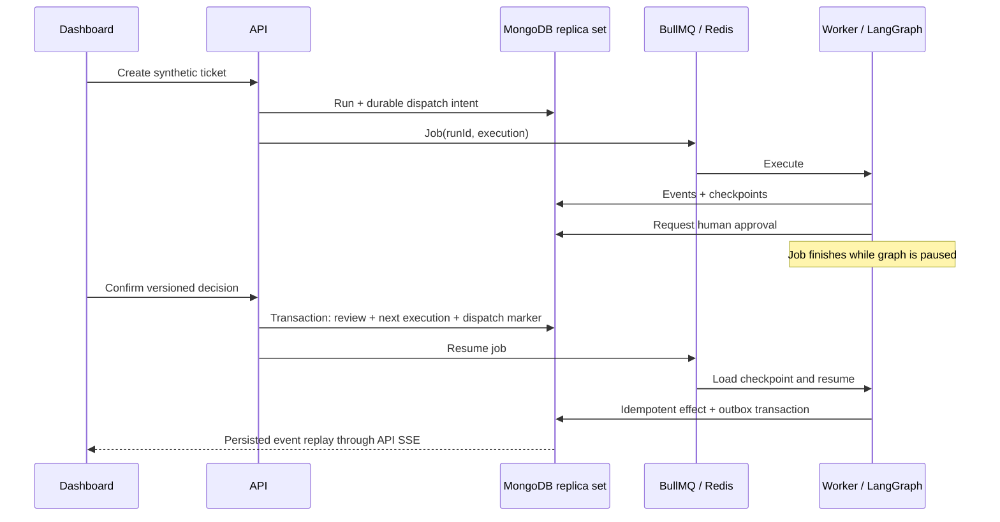

# Architecture

Author: **Jahid Khan Tuhin — Full Stack JavaScript Engineer**

## Request, execution and recovery

The Next.js dashboard proxies a narrow set of API paths and forwards the browser session. Express validates shared Zod contracts, checks Better Auth membership/RBAC, persists a run and dispatches a BullMQ job. A durable dispatch marker lets the API reconcile a committed run after a queue outage. The API does not execute the workflow graph.

The worker executes LangGraph with `thread_id = runId` and synchronous MongoDB checkpoint durability. BullMQ renews a job lock while the process is alive; a replacement worker can reclaim a stalled job after a crash. Checkpoints preserve completed graph steps. An interrupted step can execute again, including after an effect committed but before its checkpoint. Stable effect keys protect that boundary. A fork receives a different run ID and fresh effect scope; it does not share effect receipts with its parent.

## Storage boundaries

MongoDB runs as a replica set so transactions can combine effects, receipts, review resolution and event updates. Repositories validate documents and centralize indexes. `runs` stores current status/execution; `runEvents` is append-only ordered history; LangGraph checkpoint collections preserve graph state. `approvals` contains proposal/version/quorum/reviews and the SLA snapshot. Versioned policies and stored decision traces explain why review was required.

`idempotencyKeys` has a unique stable effect key. Fake refunds and email intents are written transactionally with their receipts. `outbox` records durable delivery intent; `localDeliveries` records acknowledgement. `fakeRefunds` and `fakeEmails` show current local effect state, including reversal/correction. A saga retains original history and compensates committed actions in reverse order. Redis provides queue locks/jobs, not the source of truth for business results.

## Human control and channels

Web, signed links, Telegram and WhatsApp share the approval service. Current membership, action permissions, proposal version and distinct-reviewer requirements are rechecked. The first edited review freezes the proposed text for later reviewers. Signed tokens bind reviewer, approval/version, action and expiry; token consumption and review mutation commit together. Opening a signed link is read-only.

Telegram and WhatsApp are optional, with signed/secret-authenticated webhook handlers separate from browser session routes. Pairing is private, expiring and single-use. WhatsApp additionally requires a verified inbound reply window and provider capabilities that allow the custom content. Trial account connection/limits and actual device delivery need independent validation. The web fallback needs neither channel.

The PWA is network-only. It does not cache private responses, approve offline or bundle the backend. The global bell shares one authenticated polling provider across responsive header placements and filters actionable requests for the current reviewer. Alerts are in-app; they are not browser-closed push notifications.

## SLA and observability

New approvals snapshot per-workflow reminder, role escalation and timeout policy. API reconciliation rebuilds missing delayed jobs in a namespaced SLA queue. Stage timestamps/event keys make repeated processing harmless. Transactions arbitrate timeout against human action; neither a timeout nor escalation approves a risky action. Expiry can reject through the workflow's rejection path or cancel directly.

AsyncLocalStorage associates run, execution, node and attempt with OpenTelemetry spans and model usage. Trace IDs group executions of the same run; forks have separate IDs. Span summaries and usage are stored locally. The optional Compose collector receives OTLP/HTTP and prints debug traces; it is not a hosted trace-search product. Returned model usage and configured rates produce known cost estimates; incomplete usage is not an invoice.

## Safety and limits

- Payments are fake MongoDB records. Email is restricted to local Mailpit; recipients use `.test` addresses. Publication is local. All CI models/messaging providers are mocked.
- Chaos controls require development configuration, an admin and the runtime enable state. Supervisors restart owned API/worker child processes without a Docker socket.
- Arbitrary external side effects are not exactly-once by default. SMTP crash safety relies on the configured Mailpit receiver's Message-ID deduplication and retained data. Advisory notifications may repeat after provider acceptance before acknowledgement.
- Bounded inbox/history pages, one development workflow worker and single-node local services demonstrate semantics rather than production scale, high availability or tenancy isolation.
- No real browser/device delivery or remote CI result should be inferred from local fixture tests. Read [PROGRESS](PROGRESS.md) for measured results.
